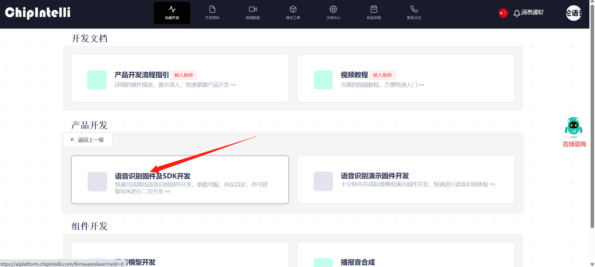
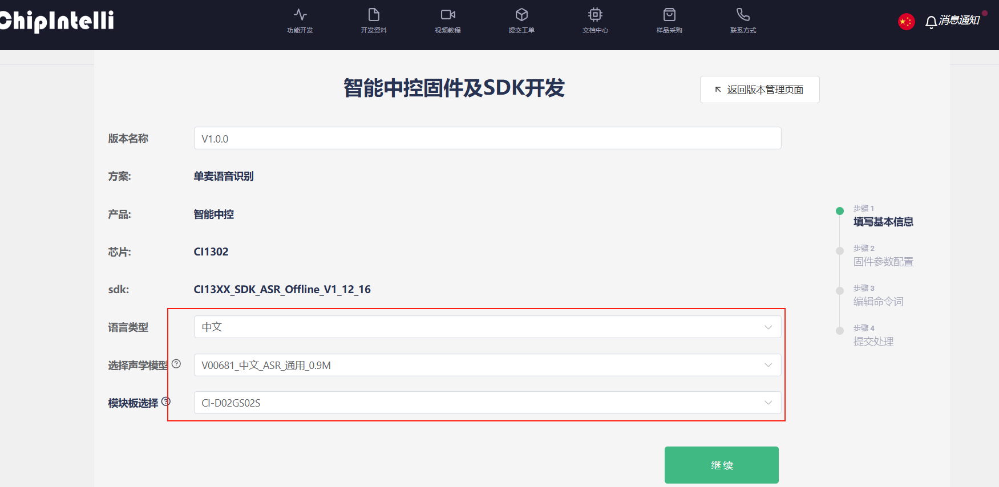
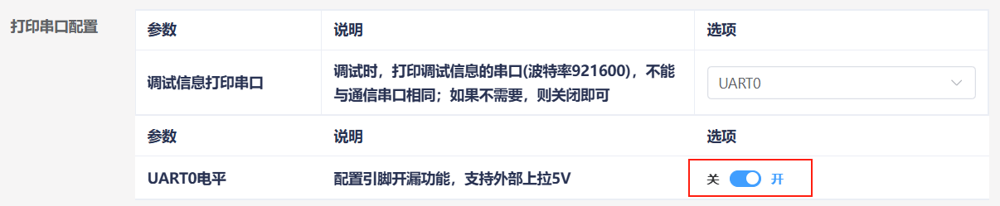
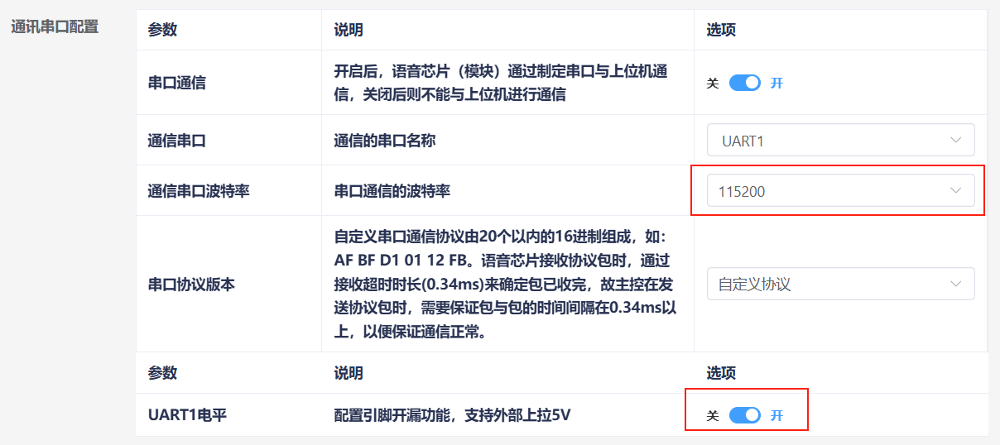
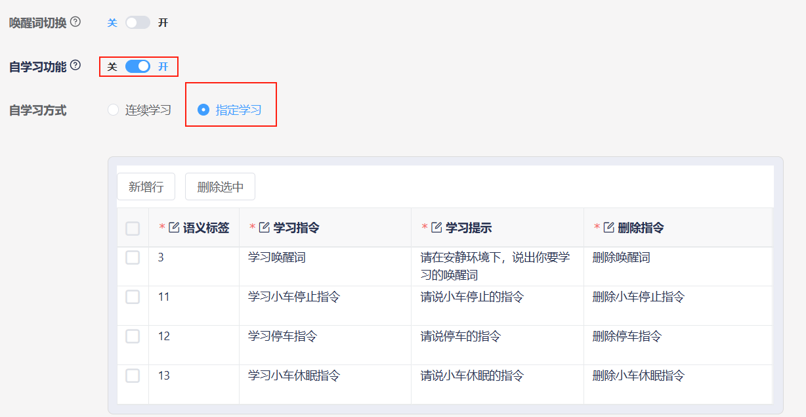
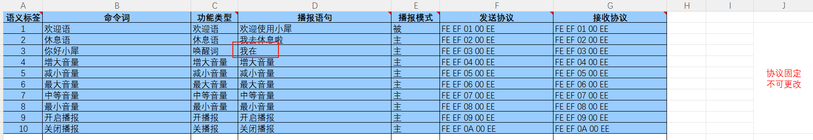

English | [简体中文](custom-protocol_CN.md)

# Custom Protocol Entry Creation

# 1. Voice Chip Firmware Creation

# 1.1 Precautions

The module comes with voice recognition firmware pre-flashed from the factory. The documentation attachments also provide the factory firmware. If you need to recreate firmware, you can follow the steps below for firmware creation.

# 1.2 Firmware Creation

First, open the "启英泰伦语音AI平台" (ChipIntelli Voice AI Platform) link to access the firmware creation website.
Click "功能开发" (Feature Development) in the menu bar, then click "离线语音识别大模型应用" (Offline Voice Recognition Large Model Application) under the Product Development section.

At this point, you will be prompted to log in. You need to register a platform account with your own information. For this tutorial, we have already registered in advance. After logging in, click "语音识别固件及SDK开发" (Voice Recognition Firmware and SDK Development) again.

After the page redirects, click "新建项目" (New Project) on the left side. Create a new product as shown below, where the product name and description can be customized. The remaining information must be selected according to the red-framed content. The product type should be "通用->智能中控" (General -> Smart Central Control). Click "创建" (Create) when done.

Next, fill in the project's basic information. Since we need Chinese recognition, select "中文" (Chinese) for the language type. If English recognition is needed, you can make the corresponding modification. Select other information as shown below, then click "继续" (Continue).

Then, configure the firmware. Here we will only explain the parts that need modification. Enable the echo cancellation option under algorithm parameters.

In hardware parameters, set the crystal oscillator source to "内部 RC" (Internal RC).

In the print serial port configuration, set the UART0 level to open-drain function, supporting external pull-up to 5V.

Modify the communication serial port configuration: set the baud rate to 115200 and configure the UART1 level to open-drain function, supporting external pull-up to 5V. After configuration, click "继续" (Continue) to proceed to the next step.

Now enter the command word editing function. First, select the playback voice. Here we choose "小蝶-清新女声 Ver.3" (Xiaodie - Fresh Female Voice Ver.3).

Next, upload the command word attachment. Find the "命令词播报词协议列表V1\_中文" (Command Word Playback Word Protocol List V1\_Chinese) spreadsheet in the same directory as this document and drag it directly into the webpage to upload.

After uploading the file, you can see our command word data in the table below.

Open the self-learning function and select "指定学习" (Specified Learning). The system will automatically generate 4 self-learning commands. We won't make any changes here.

After submitting, wait a few minutes for the firmware creation to complete. Once done, click "下载固件" (Download Firmware) to get the created firmware.

For firmware flashing steps, please refer to "4. Module Firmware Flashing Method".

# 2. Modifying Functional Entries

Open the "命令词播报词协议列表V1\_中文" (Command Word Playback Word Protocol List V1\_Chinese) file from the attachments.

Find the functional entries in the spreadsheet, which are the first 10 entries. Note that these 10 functional entries are fixed entries that cannot be added, only modified.

Here we take modifying the wake word's playback phrase as an example: change the playback from "在的" (I'm here) after recognizing "你好，小犀" to "我在" (I'm here).

Save after modification, then follow the steps in "1.2 Firmware Creation" to import the spreadsheet into the website. If you have already created firmware once, you can click the "继承" (Inherit) button in the previous project, which can save the parameter configuration steps.

After recreating the firmware, you also need to flash the firmware to the voice interaction module. This will enable the modified functional entries.

# 3. Adding New Command Entries

Open the "命令词播报词协议列表V1\_中文" (Command Word Playback Word Protocol List V1\_Chinese) file from the attachments.

At the bottom of the spreadsheet, add a new command entry. Here we take adding a "打扫房间" (Clean Room) command word as an example.

Here you need to select "命令词" (Command Word) for the function type and set the playback mode to "主" (Active). This way, after recognizing "打扫房间", it will actively play "好的" (OK).

Now let's understand the send protocol. The 1st and 2nd bytes of the data are the data frame header and do not need to be modified. When we select the function type as command word, according to the send protocol, the 3rd byte of data must be "00". This is to distinguish whether the command is a "command word" or a "playback phrase".

The 4th byte of data is the command word's data ID, which is a hexadecimal value. Since the previous command word's ID was "8B", we need to set this byte to "8C". In special cases, data IDs can be the same, for example when the results returned by two command words are identical.

The 5th byte in the protocol is fixed at "EE" and also does not need to be modified. In the spreadsheet, the send protocol and receive protocol should be consistent.

Save after modification, then follow the steps in "1.2 Firmware Creation" to import the spreadsheet into the website. If you have already created firmware once, you can click the "继承" (Inherit) button in the previous project, which can save the parameter configuration steps.

After recreating the firmware, you also need to flash the firmware to the voice interaction module. This will enable the new command entry function.

# 4. Adding New Playback Phrases

Open the "命令词播报词协议列表V1\_中文" (Command Word Playback Word Protocol List V1\_Chinese) file from the attachments.

At the bottom of the spreadsheet, add a new entry. Here we take adding a "现在是晚上" (It's Evening Now) playback phrase as an example.

Here you need to select "播报语" (Playback Phrase) for the function type and set the playback mode to "被" (Passive).

Now let's understand the send protocol. The 1st and 2nd bytes of the data are the data frame header and do not need to be modified. When we select the function type as playback phrase, according to the send protocol, the 3rd byte of data must be "FF". This is to distinguish the command as a "playback phrase".

The 4th byte of data is the command word's data ID, which is a hexadecimal value. Since the previous playback phrase's ID was "8B", we need to set this byte to "8C".

The 5th byte in the protocol is fixed at "EE" and also does not need to be modified. In the spreadsheet, the send protocol and receive protocol should be consistent.

Save after modification, then follow the steps in "1.2 Firmware Creation" to import the spreadsheet into the website. If you have already created firmware once, you can click the "继承" (Inherit) button in the previous project, which can save the parameter configuration steps.

After recreating the firmware, you also need to flash the firmware to the voice interaction module. This will enable the new command entry function.
