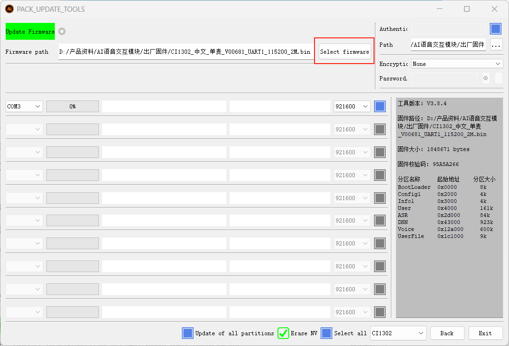
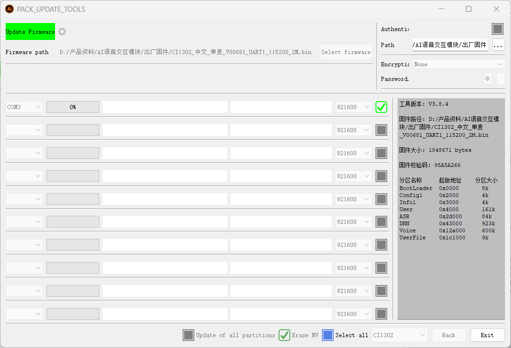
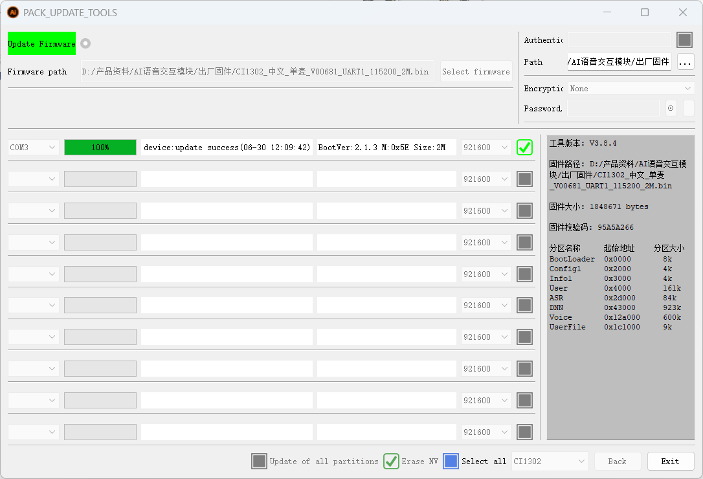

English | [简体中文](firmware-flashing_CN.md)

# Module Firmware Flashing Method

# 1. Voice Chip Flashing Steps

# 1.1 Device Connection

# 1.2 Open the Flashing Software

Open the voice chip firmware flashing tool folder in the attachments and click "PACK\_UPDATE\_TOOL.exe"

Select the CI1302 chip, then click "固件升级" (Firmware Upgrade)

Enter the firmware upgrade interface. Press "F1" to view help.

Click to select the firmware you just created. Find the factory firmware "CI1302中文单麦\_V00681\_UART1\_115200\_2M" in the attachments.

Select the firmware, find the corresponding serial port number, and check the checkbox.

Move the slide switch to the "Download" position. "Download" indicates flashing firmware for the voice chip (i.e., the right side).

After moving the switch to the corresponding position, press the RST button on the voice interaction module to enter the flashing process. Wait for the flashing to complete successfully, then click "退出" (Exit).

