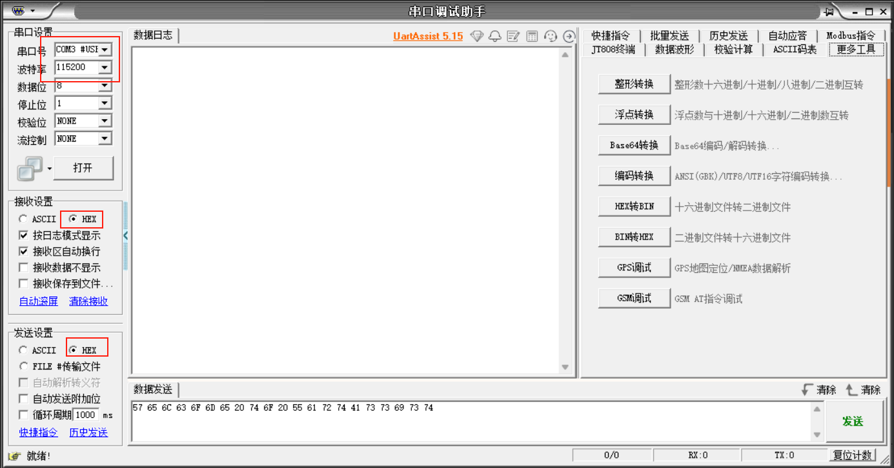
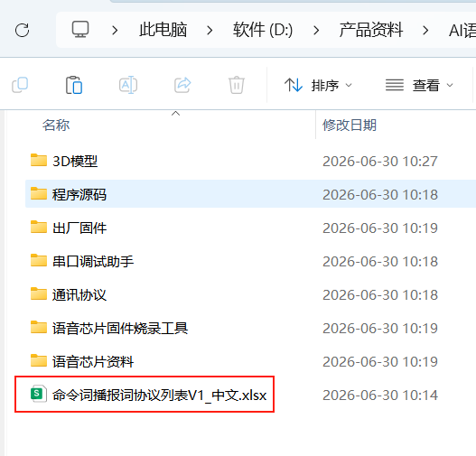
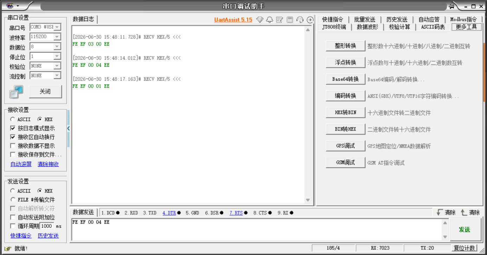
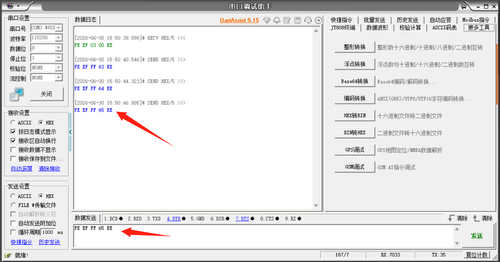

[English](../../en/07-pc-serial/pc-serial.md) | [Deutsch](../../de/07-pc-serial/pc-serial.md) | [Español](../../es/07-pc-serial/pc-serial.md) | Français | [Italiano](../../it/07-pc-serial/pc-serial.md) | [日本語](../../ja/07-pc-serial/pc-serial.md) | [한국어](../../ko/07-pc-serial/pc-serial.md) | [Português (BR)](../../pt-br/07-pc-serial/pc-serial.md) | [Português (PT)](../../pt-pt/07-pc-serial/pc-serial.md) | [简体中文](../../zh-hans/07-pc-serial/pc-serial.md) | [繁體中文](../../zh-hant/07-pc-serial/pc-serial.md)

# 1. Connexion de l'appareil

Placez le commutateur à glissière en mode port série STC8.

# 2. Ouvrir l'assistant de débogage série

- Ouvrez Uart Assistant, sélectionnez le numéro de port série correspondant et réglez le débit en bauds sur 115200.

- Reportez-vous au fichier « 命令词播报词协议列表V1\_中文 » (Liste de protocole des mots de commande et des phrases de lecture V1\_Chinois) dans l'archive.

- Lorsque nous disons « 小车前进 » (Voiture avance), l'assistant de débogage série imprimera le protocole correspondant.

| 11   | 小车停止 | Commande | 好的,已停止       | Active | FE EF 00 01 EE | FE EF 00 01 EE |
| ---- | -------- | ------- | ----------------- | ------ | -------------- | -------------- |
| 12   | 停车     | Commande | 好的,已停止       | Active | FE EF 00 02 EE | FE EF 00 02 EE |
| 13   | 小车休眠 | Commande | 好的,已休眠       | Active | FE EF 00 03 EE | FE EF 00 03 EE |
| 14   | 小车前进 | Commande | 好的,正在前进     | Active | FE EF 00 04 EE | FE EF 00 04 EE |
| 15   | 小车后退 | Commande | 好的,正在后退     | Active | FE EF 00 05 EE | FE EF 00 05 EE |
| 16   | 小车左转 | Commande | 好的,正在向左转   | Active | FE EF 00 06 EE | FE EF 00 06 EE |
| 17   | 小车右转 | Commande | 好的,正在向右转   | Active | FE EF 00 07 EE | FE EF 00 07 EE |
| 18   | 小车左旋 | Commande | 好的,正在向左旋转 | Active | FE EF 00 08 EE | FE EF 00 08 EE |
| 19   | 小车右旋 | Commande | 好的,正在向右旋转 | Active | FE EF 00 09 EE | FE EF 00 09 EE |

- Conformément au fichier « 命令词播报词协议列表V1\_中文 », saisissez la commande correspondante, et le module vocal lira le texte du protocole correspondant.

| 84   | 这是红色                  | Commande | 这是红色                  | Passive | FE EF FF 5F EE | FE EF FF 5F EE |
| ---- | ------------------------- | ------- | ------------------------- | ------- | -------------- | -------------- |
| 85   | 这是蓝色                  | Commande | 这是蓝色                  | Passive | FE EF FF 60 EE | FE EF FF 60 EE |
| 86   | 这是绿色                  | Commande | 这是绿色                  | Passive | FE EF FF 61 EE | FE EF FF 61 EE |
| 87   | 这是黄色                  | Commande | 这是黄色                  | Passive | FE EF FF 62 EE | FE EF FF 62 EE |
| 88   | 识别到黄色                | Commande | 识别到黄色                | Passive | FE EF FF 63 EE | FE EF FF 63 EE |
| 89   | 识别到绿色                | Commande | 识别到绿色                | Passive | FE EF FF 64 EE | FE EF FF 64 EE |
| 90   | 识别到蓝色                | Commande | 识别到蓝色                | Passive | FE EF FF 65 EE | FE EF FF 65 EE |
| 91   | 识别到红色                | Commande | 识别到红色                | Passive | FE EF FF 66 EE | FE EF FF 66 EE |
| 92   | 初始化完成                | Commande | 初始化完成                | Passive | FE EF FF 67 EE | FE EF FF 67 EE |
| 93   | 第一个要排序的颜色是      | Commande | 第一个要排序的颜色是      | Passive | FE EF FF 68 EE | FE EF FF 68 EE |
| 94   | 第二个要排序的颜色是      | Commande | 第二个要排序的颜色是      | Passive | FE EF FF 69 EE | FE EF FF 69 EE |
| 95   | 第三个要排序的颜色是      | Commande | 第三个要排序的颜色是      | Passive | FE EF FF 6A EE | FE EF FF 6A EE |
| 96   | 第四个要排序的颜色是      | Commande | 第四个要排序的颜色是      | Passive | FE EF FF 6B EE | FE EF FF 6B EE |
| 97   | 这是易拉罐,属于可回收垃圾 | Commande | 这是易拉罐,属于可回收垃圾 | Passive | FE EF FF 6C EE | FE EF FF 6C EE |

Vous pouvez entendre le module vocal fonctionner normalement.
