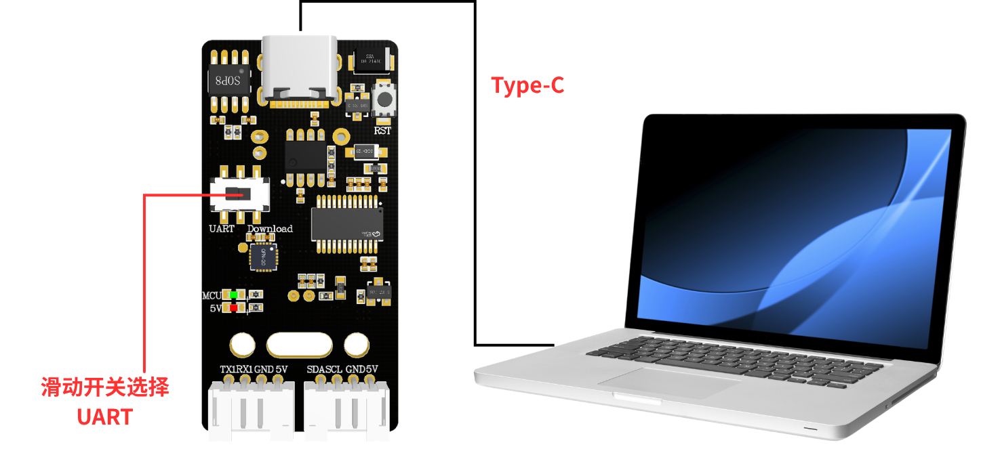
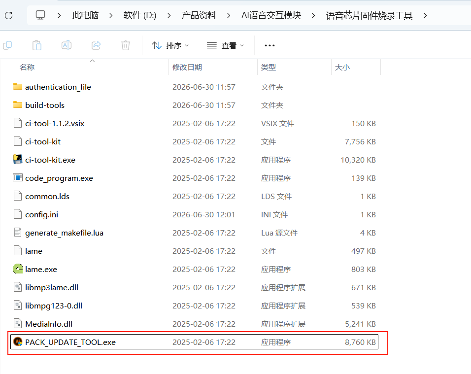
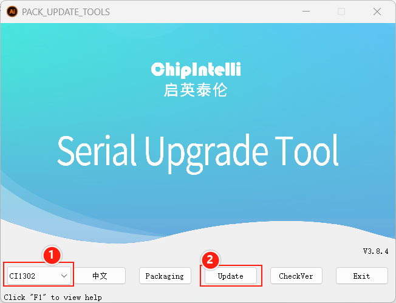
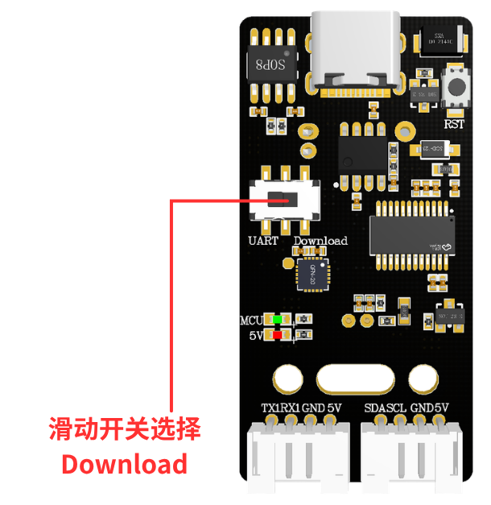
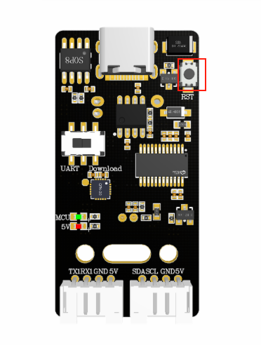
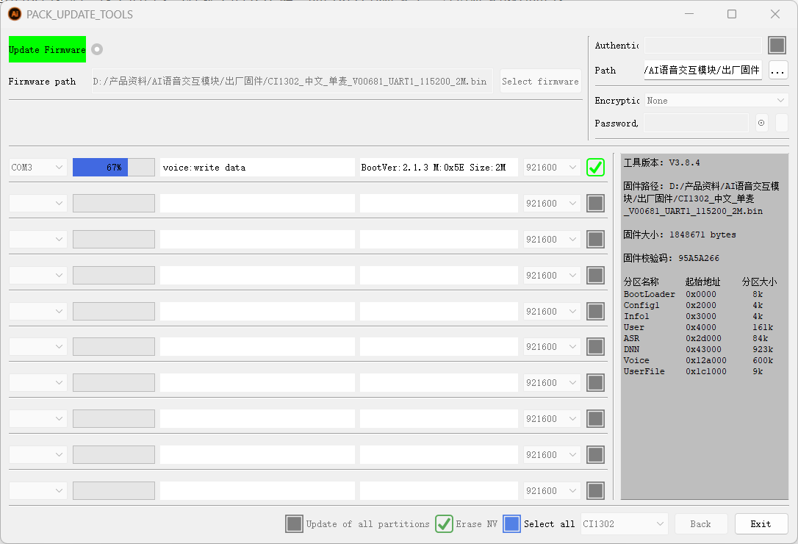

[English](../../en/05-firmware-flashing/firmware-flashing.md) | [Deutsch](../../de/05-firmware-flashing/firmware-flashing.md) | [Español](../../es/05-firmware-flashing/firmware-flashing.md) | [Français](../../fr/05-firmware-flashing/firmware-flashing.md) | Italiano | [日本語](../../ja/05-firmware-flashing/firmware-flashing.md) | [한국어](../../ko/05-firmware-flashing/firmware-flashing.md) | [Português (BR)](../../pt-br/05-firmware-flashing/firmware-flashing.md) | [Português (PT)](../../pt-pt/05-firmware-flashing/firmware-flashing.md) | [简体中文](../../zh-hans/05-firmware-flashing/firmware-flashing.md) | [繁體中文](../../zh-hant/05-firmware-flashing/firmware-flashing.md)

# Metodo di flashing del firmware del modulo

# 1. Passaggi per il flashing del chip vocale

# 1.1 Collegamento del dispositivo

# 1.2 Apertura del software di flashing

Apri la cartella dello strumento di flashing del firmware del chip vocale negli allegati e clicca su "PACK\_UPDATE\_TOOL.exe"

Seleziona il chip CI1302, poi clicca su "固件升级" (Aggiornamento firmware)

Entra nell'interfaccia di aggiornamento del firmware. Premi "F1" per visualizzare la guida.

Clicca per selezionare il firmware appena creato. Trova il firmware di fabbrica "CI1302中文单麦\_V00681\_UART1\_115200\_2M" negli allegati.

Seleziona il firmware, trova il numero della porta seriale corrispondente e spunta la casella di controllo.

Sposta l'interruttore a slitta nella posizione "Download". "Download" indica il flashing del firmware per il chip vocale (cioè il lato destro).

Dopo aver spostato l'interruttore nella posizione corrispondente, premi il pulsante RST sul modulo di interazione vocale per avviare il processo di flashing. Attendi il completamento corretto del flashing, poi clicca su "退出" (Esci).

