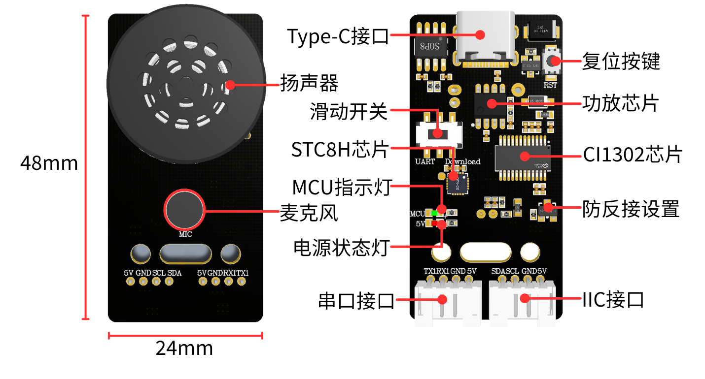

[English](../../en/02-module-overview/module-overview.md) | [Deutsch](../../de/02-module-overview/module-overview.md) | [Español](../../es/02-module-overview/module-overview.md) | [Français](../../fr/02-module-overview/module-overview.md) | [Italiano](../../it/02-module-overview/module-overview.md) | [日本語](../../ja/02-module-overview/module-overview.md) | [한국어](../../ko/02-module-overview/module-overview.md) | [Português (BR)](../../pt-br/02-module-overview/module-overview.md) | Português (PT) | [简体中文](../../zh-hans/02-module-overview/module-overview.md) | [繁體中文](../../zh-hant/02-module-overview/module-overview.md)

# Informação do Produto

## 1. Introdução ao Módulo de Interação por Voz

O CI1302 é um chip de voz inteligente de rede neuronal de alto desempenho de nova geração desenvolvido pela ChipIntelli. Integra o processador de rede neuronal Brain BNPU V3, desenvolvido pela própria ChipIntelli, e um núcleo de CPU, com uma frequência de relógio do sistema até 220 MHz, SRAM integrada até 640 KB, unidade de gestão de energia PMU e oscilador RC integrados, bem como um codec de áudio de dois canais de alto desempenho e baixo consumo e várias interfaces de controlo de periféricos como UART, IIC, IIS, PWM, GPIO e PDM. O chip requer apenas alguns componentes externos, como resistências e condensadores, para implementar diversas soluções de hardware de produtos de voz inteligente, oferecendo uma relação custo-benefício excecional.

Recorrendo à tecnologia de hardware BNPU de 3.ª geração, suporta redes neuronais como DNN, TDNN, RNN e CNN, bem como operações vetoriais paralelas, permitindo funções como reconhecimento de voz, reconhecimento de impressão vocal, autoaprendizagem de palavras de comando, deteção de voz e redução de ruído por aprendizagem profunda. A solução do chip também suporta várias línguas globais, incluindo chinês, inglês e japonês, tornando-a amplamente aplicável em eletrodomésticos, iluminação, brinquedos, dispositivos vestíveis, aplicações industriais, automóveis e outros campos de produtos para interação por voz, controlo e diversas aplicações de soluções de voz inteligente.

O chip CI1302 dispõe de um núcleo de processador de rede neuronal Brain (BNPU), que suporta computação de aceleração de redes neuronais offline e aceleração de hardware para processamento de sinais de voz. A frequência do CPU atinge até 220 MHz, permitindo reconhecimento de voz offline de campo distante, com armazenamento FLASH integrado de 2 MB que suporta até 300 palavras de comando.

## 2. Características do Produto

- Pré-carregado com mais de 110 comandos de voz, suportando palavras de comando personalizáveis em chinês e inglês.

Os utilizadores podem modificar as palavras de comando através da interface web que fornecemos, gerar novos ficheiros de firmware e gravar o firmware no módulo através do software de PC, após o que o módulo reconhecerá os novos comandos. O espaço de armazenamento integrado de 2 MB suporta a gravação de aproximadamente 120 palavras de comando.

- Altifalante de alta fidelidade e microfone de alto desempenho integrados.

Integra algoritmos avançados e tecnologia de redução de ruído de circuito para filtrar eficazmente o ruído de fundo do ambiente, alcançando uma taxa de reconhecimento de 99% num raio de 5 metros, permitindo conversação natural e cancelamento de eco. Proporciona uma saída de áudio clara e reproduz com precisão os detalhes da voz.

- Coprocessador a bordo e interfaces IIC/Série/UART/Type-C.

Integra o chip STC8H, que converte automaticamente os dados de voz em formatos de dados de série ou IIC, simplificando o processo de comunicação com dispositivos anfitriões externos. É fornecido gratuitamente um conjunto variado de cabos de ligação, permitindo aos utilizadores ligar-se a placas de desenvolvimento MCU e a dispositivos anfitriões embebidos para permitir a comunicação e criar os seus próprios projetos DIY.

- Fornece tutoriais de utilização baseados em várias placas de desenvolvimento.

Fornece informações sobre placas de desenvolvimento como STM32, ESP32, MSPM0, Raspberry Pi, placas da série Jetson, RDK, etc. Fornece também ficheiros SDK para os sistemas ROS1 e ROS2.

## 3. Princípio de Funcionamento

O módulo adota um modo de ativação por palavra-chave. O utilizador tem de dizer a palavra de despertar predefinida para ativar primeiro o módulo de interação por voz. Após a ativação, é possível realizar o reconhecimento de voz. A palavra-chave de despertar predefinida do firmware de fábrica é "你好，小犀" (Olá, Xiao Xi). Se não for detetada voz dentro de 15 segundos, o módulo entra em modo de suspensão e tem de ser acordado novamente para utilização posterior.

Quando o chip CI1302 reconhece a entrada de voz correspondente, envia-a através da porta série e da interface IIC, juntamente com a reprodução de retorno. O chip IIC armazena os comandos de voz recebidos e envia-os através do protocolo de escravo IIC.

O módulo suporta a modificação da palavra de despertar, a modificação das palavras de comando e a criação de entradas personalizadas. Pode aprender a operar estas funcionalidades nos tutoriais "Modificação de Palavras de Despertar e Palavras de Comando" e "Criação de Entradas de Protocolo Personalizado".

## 4. Precauções

1. Utilize uma tensão de 5 V para a alimentação; exceder os 5 V danificará o módulo.
2. O ambiente de utilização deve ser silencioso; ambientes ruidosos afetarão o desempenho do reconhecimento.
3. Ao dizer as entradas, a voz deve ser forte e não demasiado rápida. Recomenda-se que se mantenha a menos de 5 metros do módulo.

## 5. Descrição das Interfaces de Hardware

| N.º | Nome do Hardware         | Descrição                                                                 |
| --- | --------------------- | --------------------------------------------------------------------------- |
| 1   | Altifalante              | Converte sinais analógicos em som                                         |
| 2   | Interruptor Deslizante   | Alterna o modo de porta série para a gravação de firmware                 |
| 3   | Microfone                | Converte som em sinais analógicos                                         |
| 4   | Botão RST                | Botão de reposição                                                        |
| 5   | Indicador de Alimentação (Azul)| Permanece aceso quando a alimentação está normal                   |
| 6   | Porta Type-C             | Utilizado para a alimentação e atualização/descarregamento do firmware CI1302/STC8 |
| 7   | Chip Amplificador de Áudio | Converte sinais digitais em sinais analógicos para acionar o altifalante |
| 8   | Chip CI1302              | Chip de reconhecimento de voz de alto desempenho; reconhece a voz e emite sinais |
| 9   | Proteção contra Polaridade Inversa | Proteção contra a ligação invertida de 5V/GND                |
| 10  | Interface IIC            | Funciona como escravo para a alimentação e a comunicação com o dispositivo anfitrião |
| 11  | Interface Série          | Porta série externa disponibilizada; permite controlar a reprodução através de protocolo |
| 12  | Chip STC8H               | Converte os comandos do chip de voz em comandos de protocolo IIC e comandos de série |
