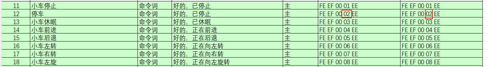
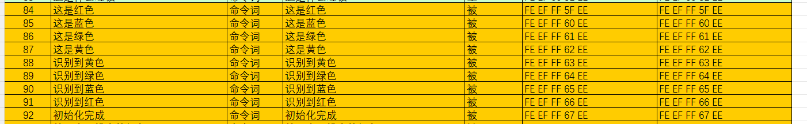
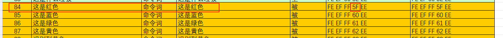
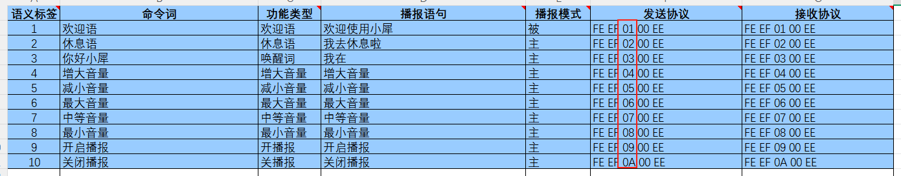
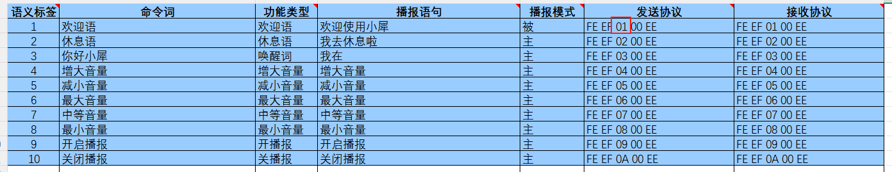
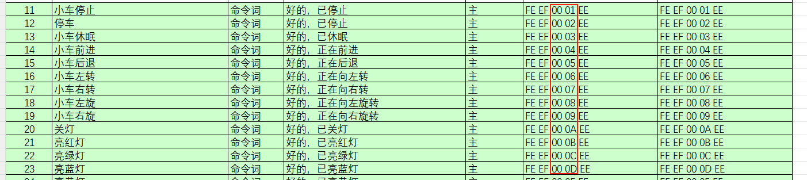
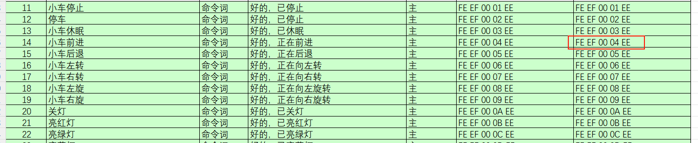

English | [简体中文](README_CN.md)

Note: the host device and the voice interaction module may use separate power supplies, but their grounds must be connected when they are wired together, so that a stable communication level is maintained.

# 1. The module acts as an I2C slave

Receiving and parsing signals from the host:

The module waits for an I2C interrupt. When I2C data arrives it calls the function matching the register address it received.

Handling data and responding:

When the module receives a register-read command it calls the corresponding send function to return the recognised data to the host.

# 2. I2C device address and register functions

The module's I2C slave address is `0x2A`.

| Register | Function |
| -------- | -------- |
| `0xDA` | Holds the recognition result. The host reads one byte — the ID of the recognised command word. (`0x00` means nothing was recognised.) |
| `0xD1` | Sets which passive announcement phrase to play. The host writes one byte. (Writing `0x00` selects the passive announcement phrase type.) |
| `0xD2` | Sets which function word phrase to play. The host writes one byte. (Writing `0x00` selects the function word phrase type.) |
| `0xD3` | Sets which command word phrase to play. The host writes one byte. (Writing `0x00` selects the command word phrase type.) |

# 3. Getting command word entries

Open the attached command word / announcement phrase protocol list (`../../docs/command-words-v1-zh.xlsx`). You will see that the frames start with `0xFE 0xED`, end with `0xEE`, and carry two bytes in between — the function type and the ID.

When the module recognises the command word "停车" (stop), it responds "好的，已停止", and the host can read a single byte `0x02` from the recognition register (`0xDA`) — the same value as the fourth byte of the "停车" frame.

# 4. Announcement phrases

Announcement phrases are never played unprompted — the host has to set them over I2C. (A command word's announcement phrase can also be played this way.)

The host writes one byte to the announcement register (`0xD1`) — the ID of the phrase — and the module plays the corresponding sentence. `0xFF` selects a plain announcement phrase.

Example:

to play "这是红色", the host writes `0x5F` to the announcement register (`0xD1`) and the module plays "这是红色".

# 5. Function word phrases

Function word phrases can be played when their command word is recognised, or triggered by writing a specific byte over I2C.

The host writes one byte to register `0xD2` — the phrase ID — and the module plays the corresponding sentence. `0xFF` selects a plain announcement phrase.

Example:

to play "欢迎使用小犀", the host writes `0x01` to register `0xD2` and the module plays "欢迎使用小犀".

# 6. Command word phrases

Command word phrases can be played when their command word is recognised, or triggered by writing a specific byte over I2C.

The host writes one byte to register `0xD3` — the phrase ID — and the module plays the corresponding sentence. `0xFF` selects a plain announcement phrase.

Example:

to play "好的，正在前进", the host writes `0x04` to register `0xD3` and the module plays "好的，正在前进".

