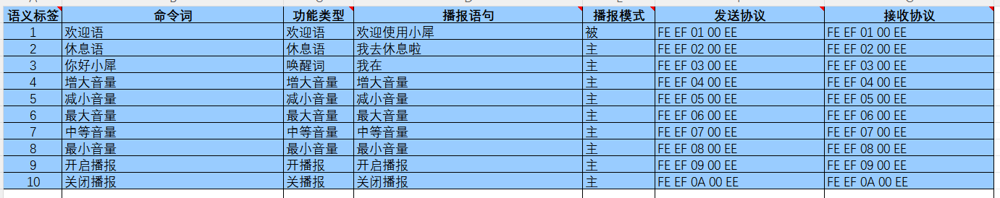
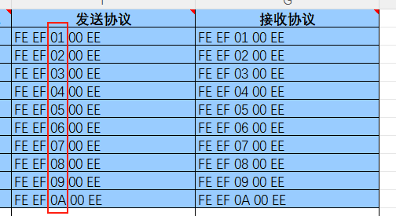
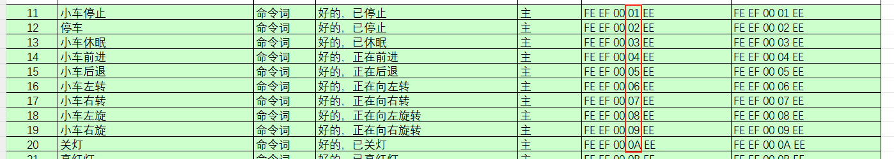
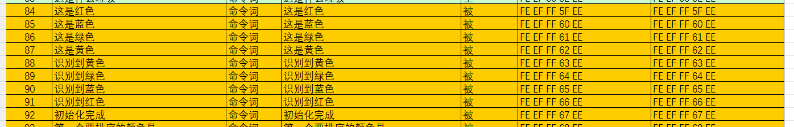

[English](README.md) | 简体中文

打开 `../../docs/command-words-v1-zh.xlsx` 文件，能看到发送协议和接收协议，

# 1.功能性词条解析

根据文件能看到10个功能性词条的发送和接收协议，

功能性词条我们可以通过解析协议的第三个字节来区分

其中第一第二个字节（FE EF）表示帧头，第三个字节表示功能字的ID，第四个字节表示命令词的ID，第五个字节（EE）表示帧尾

# 2.命令词条

命令词条示例如下，命令词中的第四个字节表示ID

例子：

比如我们对模块说小车停止，模块会通过串口发送FE EF 00 01 EE五个字节，我们可以通过主控串口服务函数获取到这一组数据，之后通过解析第四个字节得到ID:01，这个时候就得知现在是小车停止。

# 3.播报语词条

播报语词条不会主动播报，必须要主控通过串口发送指令才会进行播报（命令词条的播报语也可以进行播报）。

其中第一第二个字节（FE EF）表示帧头，第三个字节表示播报功能FF的，第四个字节表示需要播报内容的ID，第五个字节（EE）表示帧尾

例子：

但我们需要播报“初始化完成”时，主控需要通过串口发送FE EF FF 67 EE给语音交互模块，发送完成之后，语音交互模块即可播报“初始化完成”

